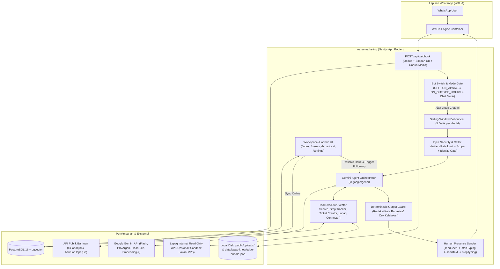
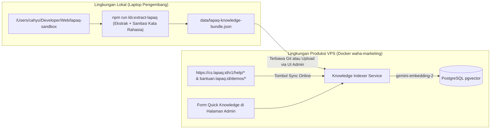

# Arsitektur Sistem & Portabilitas VPS: Agentic Customer Service

Dokumen ini menjelaskan komponen teknis, aliran pemrosesan pesan masuk/keluar, strategi *routing* model Gemini, mekanisme sinkronisasi pengetahuan, serta cara memastikan sistem berjalan mulus baik di lingkungan pengembangan lokal maupun saat di-deploy ke Docker VPS produksi.

---

## 1. Gambaran Umum Komponen

---

## 2. Aliran Pemrosesan Pesan Masuk (Inbound Lifecycle)

Setiap pesan masuk melalui `POST /api/webhook` di `src/app/api/webhook/route.ts` melewati urutan deterministik berikut:

1. **Deduplikasi & Persistensi Dasar (Selalu Berjalan)**:
   - Deduplikasi memori (`msg-cache.ts`) dan database (`P2002` atomic insert), normalisasi JID/LID, penyimpanan `Contact`, `Chat`, dan `Message`, serta pengunduhan media gambar/audio ke `public/uploads/` (`waha-media.ts`).
2. **Pemeriksaan Gerbang Eksekusi Bot (*Bot Gate*)**:
   - **Abaikan segera (0 proses AI)** apabila:
     - Pesan berasal dari kita sendiri (`fromMe === true`) atau berasal dari grup (`@g.us`).
     - Saklar Master Bot bernilai `OFF`.
     - Saklar Master Bot bernilai `ON_OUTSIDE_HOURS` dan waktu saat ini berada **di dalam** jam kerja operasional (`workStart`–`workEnd` WIB).
     - `chat.agentMode` bernilai `HUMAN_TAKEOVER` (sedang ditangani manusia).
     - *Catatan khusus `WAITING_TECH`*: Jika chat sedang berstatus `WAITING_TECH`, Agent hanya merespons sopan singkat (misal menerima jawaban *"boleh kak"* atas izin *follow-up* atau memberi tahu bahwa kendala sebelumnya masih dalam antrean tim teknis, kecuali user menanyakan topik baru yang terpisah).
3. **Sliding-Window Message Debouncer (`src/lib/agent/debouncer.ts`)**:
   - Menyimpan timer aktif per `chatId` (default `5000 ms`).
   - Setiap kali pesan baru dari `chatId` yang sama masuk sebelum timer habis, timer di-reset kembali ke 5 detik.
   - Saat hening tercapai, seluruh pesan yang belum dijawab dalam jendela tersebut (teks beruntun + gambar *screenshot* + *quoted context*) dikumpulkan menjadi satu paket giliran (*turn*).
4. **Verifikasi Pengirim & Kuota Keamanan**:
   - Memeriksa batas harian balasan AI per chat (`aiTurnCountToday` vs kuota maksimum di pengaturan).
   - Menentukan status verifikasi nomor pengirim (`VERIFIED_OWNER` jika cocok dengan nomor merchant terdaftar, selain itu `UNVERIFIED_CALLER`).
5. **Eksekusi Orchestrator & Tool Calling**:
   - Memuat konteks: *System Prompt Persona (Cached)* + *MerchantMemory* + *Active Guide State* / *Campaign Context* + *15–20 pesan terakhir* + lampiran file gambar/audio dari `public/uploads/`.
   - Memanggil model Gemini yang sesuai untuk memilih tool (`search_case_memory`, `search_lapaq_knowledge`, `get_merchant_diagnostic`, `update_guide_step`, `create_escalation_issue`) dan menyusun respons empatik singkat.
6. **Deterministic Output Guard (`src/lib/agent/security-guard.ts`)**:
   - Memeriksa draf teks sebelum dikirim. Jika melanggar daftar hitam kata internal atau menjanjikan *refund*, draf ditahan dan diganti kalimat eskalasi aman.
7. **Simulasi Kehadiran Manusia & Pengiriman (`waha.ts`)**:
   - Memanggil `waha.sendSeen(chatId)` -> jeda 1–1,5 detik -> `waha.startTyping(chatId)` -> jeda proporsional `min(5000, max(1800, panjangKarakter * 22))` ms -> `waha.stopTyping(chatId)` -> `waha.sendText(chatId, replyText)`.
   - Mencatat `Message` keluar ke PostgreSQL dan menandai ID pesan di `msg-cache` agar pantulan webhook keluar tidak tercatat ganda.
8. **Pembaruan Memori Latar Belakang (Asinkron / Non-Blocking)**:
   - Setiap beberapa pertukaran pesan atau saat isu selesai, memicu model ringan (`gemini-2.5-flash-lite`) untuk memperbarui ringkasan `MerchantMemory` tanpa menghambat pengiriman chat.

---

## 3. Strategi Routing Multi-Model Gemini (`@google/genai`)

Sistem menggunakan SDK resmi `@google/genai` dengan pembagian tugas berdasarkan kompleksitas dan biaya:

| Tier | Model Default (Dapat Diubah di Admin) | Tugas Spesifik | Pengaturan Kunci |
| :--- | :--- | :--- | :--- |
| **Primary Conversational & Multimodal** | `gemini-3.8-flash` *(atau `gemini-4-hydrogen`)* | Menangani ~90% obrolan harian, empati awal, panduan langkah demi langkah, triase 3 audiens, serta pembacaan *screenshot* standar & *voice note*. | `thinkingLevel: LOW`, *Tool Calling* aktif, respons cepat & natural. |
| **Deep Diagnostic Fallback** | `gemini-4-argon` *(atau `gemini-4-carbon`)* | Dipanggil ketika terjadi kegagalan berulang pada kendala ganjil (Kasus 2) atau saat *screenshot* layar memerlukan penalaran tata letak visual yang rumit sebelum memutuskan eskalasi. | `thinkingLevel: MEDIUM` / `HIGH`, penalaran mendalam untuk kasus anomali. |
| **Background Summarizer** | `gemini-3.5-flash-lite` | Merangkum fakta profil percakapan ke `MerchantMemory` dan merapikan ringkasan gejala tiket `SupportIssue`. | `thinkingLevel: MINIMAL`, `maxOutputTokens` kecil (`<= 220`). |
| **Semantic Vectorizer** | `gemini-embedding-2` | Menghasilkan vektor `768` dimensi (Matryoshka Representation Learning) untuk `KnowledgeChunk` dan `CaseMemory`. | Dimensi dikunci konsisten pada `768` untuk efisiensi indeks HNSW `pgvector`. |

### Pemanfaatan Context Caching
Instruksi dasar yang statis dan berukuran besar (*Aturan Persona + Daftar Menu Resmi Lapaq + Aturan Keuangan Terkunci + Protokol Keamanan*) disimpan menggunakan fitur **Gemini Context Caching** dengan masa berlaku diperbarui otomatis saat aktif, sehingga memangkas biaya token input berulang dan mempercepat respons.

---

## 4. Arsitektur Portabilitas Lokal vs VPS Produksi

Salah satu syarat utama sistem ini adalah **tetap berjalan 100% mandiri saat di-deploy ke VPS Docker** walaupun repositori `/Users/cahyo/Developer/Web/lapaq` maupun `/Users/cahyo/Developer/Web/lapaq-sandbox` hanya berada di komputer lokal pengembang.

### A. Pemisahan Pipeline Pengetahuan (3 Jalur)

1. **Jalur 1 — Bundel Pengetahuan Repo (`data/lapaq-knowledge-bundle.json`)**:
   - Dibuat di lokal menggunakan script ekstraktor dari `lapaq-sandbox`. Berisi peta rute halaman, daftar 14 add-on + letak pengaturannya, aturan validasi form, daftar fitur *Segera Hadir*, dan catatan rilis terbaru yang **sudah bersih dari kode mentah maupun nama provider internal**.
   - Saat ada pembaruan di repo Lapaq, pengembang cukup men-generate ulang file ini di lokal lalu mengunggahnya lewat tombol **Upload Bundle JSON** di halaman Admin VPS (tanpa perlu rebuild image Docker) atau menyertakannya pada *deployment* berikutnya.
2. **Jalur 2 — Sinkronisasi Online Bantuan (`cs.lapaq.id` & `bantuan.lapaq.id`)**:
   - Berjalan langsung dari server VPS melalui HTTP `GET` ke endpoint publik katalog bantuan Lapaq. Hanya meng-embed ulang tutorial/demo yang memiliki perubahan konten (*hash/timestamp diff*) agar hemat kuota API.
3. **Jalur 3 — Quick Knowledge Admin**:
   - Entri teks langsung dari database `waha-marketing` yang dibuat Admin melalui UI web untuk informasi operasional cepat (misal promo baru atau gangguan ekspedisi sementara).

### B. Konektor Data Merchant Adaptif (`LapaqBridgeClient`)

Modul `src/lib/agent/lapaq-bridge.ts` beroperasi dalam dua mode transparan berdasarkan konfigurasi `LAPAQ_INTERNAL_API_URL`:

1. **Mode `STANDALONE` (Default Aman di VPS bila URL Kosong)**:
   - Tidak melakukan panggilan jaringan ke server Lapaq eksternal.
   - Konteks merchant diambil dari tabel `Contact` lokal (`storeName`, `businessCategory`, `accountCreatedAt`, `onboardingStage`, `tags`, `ContactNote`) yang diisi lewat fitur Import CSV/Excel Merchant, ditambah klarifikasi interaktif dan analisa *screenshot* di chat.
2. **Mode `API_CONNECTED` (Saat Terhubung ke `lapaq-sandbox` Lokal atau Endpoint Read-Only Lapaq VPS)**:
   - Memanggil endpoint internal dengan header `x-internal-cs-key` dan *timeout* ketat (`3000 ms`).
   - Jika endpoint eksternal lambat atau gagal dihubungi (*timeout* / `5xx`), otomatis melakukan **graceful fallback** ke data `Contact` lokal tanpa menggagalkan percakapan WhatsApp.

---

## 5. Penanganan Kegagalan & Ketahanan Sistem (*Resilience*)

- **Kegagalan / Rate-Limit Gemini API**: Jika model utama mengalami `429` / `503` setelah 1 kali *retry* singkat, sistem tidak mengirim pesan error teknis ke merchant; chat ditandai `NEEDS_ATTENTION` di `/inbox` agar operator manusia dapat menindaklanjuti (atau mengirim pesan sopan bahwa staf sedang mengecek sebentar).
- **Restart Container Next.js**: Seluruh pesan masuk sudah tersimpan lebih dulu di PostgreSQL sebelum masuk ke *debouncer*. Saat inisialisasi server, pesan masuk terbaru yang belum terjawab dalam batas wajar (< 2 menit) saat mode `ON` dapat dipulihkan dengan aman.
- **Batas Harian Anti-Ban WAHA**: Pengiriman pesan proaktif (*Awareness Campaign* maupun *Follow-up Penyelesaian Tiket*) tetap mematuhi kuota `guardrail.maxDailyMessages` dan jeda acak pada `settings.ts`.
